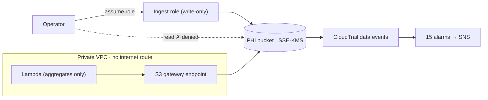

# HIPAA-style cloud reference architecture on AWS

> Designed and deployed a HIPAA-style AWS architecture for synthetic patient records, with least-privilege IAM, customer-managed KMS encryption that even the administrator can't use to decrypt, and audit logging on every record access, all written as Terraform and checked against CIS and the HIPAA Security Rule.

**Status:** deployed and verified on Oct 30, 2026 in a lab account. This is a lab build, meant to be torn down after testing; rebuild it with `make up`.

## The problem

Healthcare organizations moving patient data to the cloud have to prove three things to auditors and boards: only the right people and systems can reach the data, the data is encrypted at rest and in transit, and every access is recorded. Most reference builds show the services. This one shows the **controls working**, including the refusals: an administrator on the internet is denied, plain HTTP is denied, and the denial raises an alert.

All data is synthetic (Synthea). No real patient data is used. A real workload would also need a signed Business Associate Agreement with AWS.

## Architecture

See [docs/architecture.md](docs/architecture.md) for the full diagram and request flow.



## What was built

| Layer | Controls |
|---|---|
| Network | VPC with two private subnets across two AZs; no internet or NAT gateway; S3 gateway endpoint limited to this account's buckets; default security group and NACL closed; VPC Flow Logs |
| Encryption | Two customer-managed KMS keys (data, logs) with rotation; key policies separate administration from use; SSE-KMS everywhere; TLS required, TLS 1.2 minimum |
| Identity | Read-only app role and write-only ingest role, both under a permissions boundary; Access Analyzer; CIS password policy; account-wide Block Public Access |
| Audit and detection | Multi-region CloudTrail with log file validation and S3 data events; 15 CloudWatch alarms (CIS 4.1–4.14 plus PHI access denied); 18 AWS Config rules mapped to 164.312; GuardDuty and Security Hub for a bounded window |
| Application | Python Lambda in the private subnets that reads FHIR records through the endpoint and returns aggregate counts only |

Design reasoning: [decision log](docs/decision-log.md) (14 entries) · [threat model and risk register](docs/threat-model.md) · [HIPAA control matrix](docs/control-matrix.md)

## How to run it

Prerequisites: WSL2 Ubuntu, Terraform 1.6+, AWS CLI v2 signed in as an IAM user (not root), Docker.

```bash
make check     # fmt, validate, checkov (no AWS)
make test      # Lambda unit tests (no AWS)
make init
make plan      # review what will be created
make up        # create (type yes)
make data      # synthetic patients via Synthea (25 living, plus deceased)
make upload    # upload as the ingest role
make verify    # prove each control; saves evidence/verify-*.txt
make scan      # Prowler HIPAA checks; saves evidence/prowler/
make down      # delete everything
```

Copy `terraform/terraform.tfvars.example` to `terraform/terraform.tfvars` and set `alert_email` to receive alarms (confirm the subscription email from AWS).

## Results

`make verify` on the deployed build: **14 passed, 0 failed, 1 skipped.** The data was 34 synthetic patients (25 living, 9 deceased) from Synthea with seed 2026; no real patient data was used.

**Audit logging (164.312(b))**
- PASS: CloudTrail is logging
- PASS: Trail is multi-region with log file validation
- PASS: VPC Flow Logs active
- PASS: 15 security alarms in place

**Encryption (164.312(a)(2)(iv))**
- PASS: PHI key rotation enabled
- PASS: Log key rotation enabled
- PASS: PHI bucket default encryption uses the PHI key

**Access control (164.312(a)(1))**
- PASS: Running as an IAM user, not root
- PASS: Bucket blocks all public access
- PASS: Admin CANNOT read a patient record from the internet
- PASS: Admin CANNOT write records directly
- PASS: Ingest role CANNOT read records back

**Transmission security (164.312(e)(1))**
- PASS: Plain HTTP (no TLS) is refused

**The app path (inside the VPC, through the endpoint)**
- PASS: App reads records and returns aggregates only

**Skipped**
- SKIP: IAM Access Analyzer. The lab account is a member of an AWS Organization whose SCPs block it.

### Deployed in this run

This verify run did not set the account password policy, EBS default encryption, account-level S3 Block Public Access or Access Analyzer, and GuardDuty and Security Hub stayed off. An Organization SCP blocks this member account from managing account-level S3 Block Public Access and from using Access Analyzer, GuardDuty and Security Hub. Account-level S3 Block Public Access has to be set from the management account and is currently **not enabled**: a real gap, listed as a finding below (see ADR-001).

### AWS Config: 18 rules

11 compliant, 5 non-compliant, 2 with no result yet.

| Result | Rule | Explanation |
|---|---|---|
| Non-compliant | `cmk-backing-key-rotation-enabled` | **A gap in this build.** Config reports that its IAM role does not allow `kms:DescribeKey`, so it cannot evaluate this build's two keys. Asking KMS directly shows rotation is on for both. Re-evaluating did not change the result. A fix giving Config read access to both keys is in the code and has not been re-verified yet. |
| Non-compliant | `s3-account-level-public-access-blocks-periodic` | **A real gap.** An Organization SCP blocks this account from setting it, so it must be set from the management account. It is not enabled. Bucket-level Block Public Access is on and verified. |
| Non-compliant | `s3-bucket-versioning-enabled` | A log bucket that existed before this build. |
| Non-compliant | `vpc-default-security-group-closed` | Default security groups in two VPCs that existed before this build. This build's own default group is not flagged. |
| Non-compliant | `vpc-flow-logs-enabled` | The account's default VPC, which existed before this build. |
| No result yet | `mfa-enabled-for-iam-console-access`, `root-account-mfa-enabled` | Not evaluated at the time of this run, so these are not claimed as passing. |

### What isn't proven yet

- Alarm delivery: the denied reads in `make verify` did put the `phi-access-denied` alarm into ALARM, but no alert email was subscribed, so a notification reaching a person has not been shown.
- `verify.sh` shows the bucket policy refusing the admin. It does not separately test the KMS key policy refusing decryption.
- `verify.sh` confirms CloudTrail is logging. It does not check that a specific record read appears as a data event.
- Prowler before/after results and measured cost are still to come.

## Static analysis

`checkov` passes with 216 checks and 0 failures. 20 checks are skipped, each with a written reason in the code (for example, Lambda reserved concurrency cannot be set on a new account's low concurrency quota). Every skip is also covered in the decision log.

## What I'd do with more time or budget

- Move to an AWS Organization: log-archive and security-tooling accounts, SCPs that deny disabling CloudTrail or Config, IAM Identity Center for people.
- Object Lock on the log bucket and cross-region replication.
- A de-identified research enclave: Safe Harbor de-identification pipeline, researcher access through Athena with Lake Formation, and privacy-preserving ML (links to the quantum + ML project).
- Re-run the PQC crypto inventory against this build each quarter and track hybrid post-quantum coverage of its endpoints.

## How this connects to my other projects

- **PQC TLS lab / crypto inventory** ([pqc-tls-lab](https://github.com/errorstatle404/pqc-tls-lab)): this build sets the encryption policy; the inventory measures whether those encrypted connections are quantum-safe. Health records kept for years are the textbook "harvest now, decrypt later" target.
- **Home SOC lab** (next): the CloudTrail and Flow Logs this build produces are the cloud log source for the SOC lab's detections.
