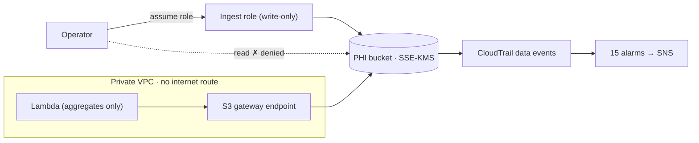

# HIPAA-style cloud reference architecture on AWS

> Designed and deployed a HIPAA-style AWS architecture for synthetic patient records, with least-privilege IAM, customer-managed KMS encryption that even the administrator can't use to decrypt, and audit logging on every record access, all written as Terraform and checked against CIS and the HIPAA Security Rule.

**Status:** deployed and verified on Oct 30, 2026 in a lab account; torn down on Oct 31, 2026. Rebuild it with `make up`.

## The problem

Healthcare organizations moving patient data to the cloud have to prove three things to auditors and boards: only the right people and systems can reach the data, the data is encrypted at rest and in transit, and every access is recorded. Most reference builds show the services. This one shows the **controls working**, including the refusals: an administrator on the internet is denied, plain HTTP is denied, and the denial raises an alert.

All data is synthetic (Synthea). No real patient data is used. A real workload would also need a signed Business Associate Agreement with AWS.

## Architecture

See [docs/architecture.md](docs/architecture.md) for the full diagram and request flow.



## What was built

| Layer | Controls |
|---|---|
| Network | VPC with two private subnets across two AZs; no internet or NAT gateway; S3 gateway endpoint limited to this account's buckets; default security group and NACL closed; VPC Flow Logs |
| Encryption | Two customer-managed KMS keys (data, logs) with rotation; key policies separate administration from use; SSE-KMS everywhere; TLS required, TLS 1.2 minimum |
| Identity | Read-only app role and write-only ingest role, both under a permissions boundary; Access Analyzer; CIS password policy; account-wide Block Public Access |
| Audit and detection | Multi-region CloudTrail with log file validation and S3 data events; 15 CloudWatch alarms (CIS 4.1–4.14 plus PHI access denied); 18 AWS Config rules mapped to 164.312; GuardDuty and Security Hub for a bounded window |
| Application | Python Lambda in the private subnets that reads FHIR records through the endpoint and returns aggregate counts only |

Design reasoning: [decision log](docs/decision-log.md) (14 entries) · [threat model and risk register](docs/threat-model.md) · [HIPAA control matrix](docs/control-matrix.md)

## How to run it

Prerequisites: WSL2 Ubuntu, Terraform 1.6+, AWS CLI v2 signed in as an IAM user (not root), Docker.

```bash
make check     # fmt, validate, checkov (no AWS)
make test      # Lambda unit tests (no AWS)
make init
make plan      # review what will be created
make up        # create (type yes)
make data      # synthetic patients via Synthea (25 living, plus deceased)
make upload    # upload as the ingest role
make verify    # prove each control; saves evidence/verify-*.txt
make scan      # Prowler HIPAA checks; saves evidence/prowler/
make down      # delete everything
```

Copy `terraform/terraform.tfvars.example` to `terraform/terraform.tfvars` and set `alert_email` to receive alarms (confirm the subscription email from AWS).

## Results

Deployed and tested on Oct 30, 2026. Full detail is in **[docs/results.md](docs/results.md)**, with a one-page summary for a board audience in **[docs/executive-brief.md](docs/executive-brief.md)**. These are results from one lab run on synthetic data, not a HIPAA compliance certification.

| Check | Result |
|---|---|
| `make verify` | 14 passed, 0 failed, 1 skipped (Access Analyzer, blocked by an Organization SCP) |
| Denied read to alarm | 6 minutes in a timed run, with the alert email received |
| CloudTrail data events | Each record read and write logged with identity and outcome, including refusals |
| AWS Config (18 rules) | 12 compliant, 4 non-compliant, 2 no result |
| Prowler HIPAA checks, `us-east-2` | 18 failures, then 12 after fixes; 2 are in this build, both a documented design choice |

**Known gaps:** account-level S3 Block Public Access is **not enabled** (an SCP blocks this member account from setting it, so it must be set from the management account). Log integrity validation has not been run, because it needs a dedicated auditor role. The MFA Config rules returned no result.

**What testing caught:** real deployment found four issues that static analysis had passed, including one that would have silently stopped flow-log delivery and an alarm that fired constantly on a trusted service's own calls. See [what they were and how they were fixed](docs/results.md#bugs-that-testing-found).

## Static analysis

`checkov` passes with 216 checks and 0 failures. 20 checks are skipped, each with a written reason in the code (for example, Lambda reserved concurrency cannot be set on a new account's low concurrency quota). Every skip is also covered in the decision log.

## What I'd do with more time or budget

- Move to an AWS Organization: log-archive and security-tooling accounts, SCPs that deny disabling CloudTrail or Config, IAM Identity Center for people.
- Object Lock on the log bucket and cross-region replication.
- A de-identified research enclave: Safe Harbor de-identification pipeline, researcher access through Athena with Lake Formation, and privacy-preserving ML (links to the quantum + ML project).
- Re-run the PQC crypto inventory against this build each quarter and track hybrid post-quantum coverage of its endpoints.

## How this connects to my other projects

- **PQC TLS lab / crypto inventory** ([pqc-tls-lab](https://github.com/errorstatle404/pqc-tls-lab)): this build sets the encryption policy; the inventory measures whether those encrypted connections are quantum-safe. Health records kept for years are the textbook "harvest now, decrypt later" target.
- **Home SOC lab** (next): the CloudTrail and Flow Logs this build produces are the cloud log source for the SOC lab's detections.
