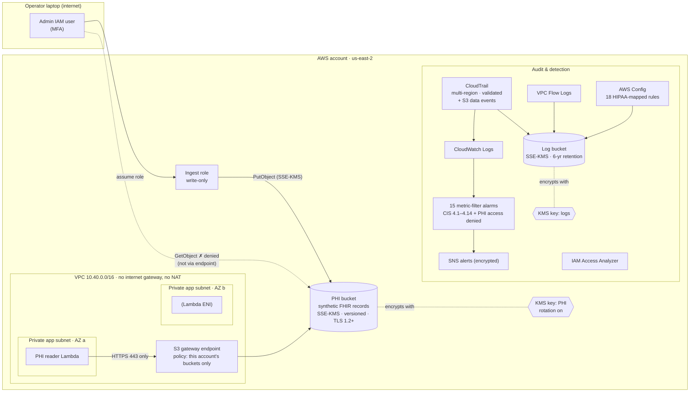

# Architecture

## How a request flows

1. **Ingest.** The operator assumes the ingest role and uploads Synthea FHIR bundles. The bucket policy refuses `PutObject` from any other principal and refuses any key other than the PHI key.
2. **Use.** The Lambda runs in private subnets with no route to the internet. Its only egress rule is HTTPS to the S3 prefix list, through the gateway endpoint. It returns aggregate counts, never record contents.
3. **Refusal.** A `GetObject` that does not arrive through the endpoint is denied by the bucket policy, even for the account administrator. So is any request without TLS, or with TLS older than 1.2.
4. **Evidence.** Every read and write of a record is a CloudTrail data event. Denied attempts on the PHI bucket raise the `phi-access-denied` alarm within about five minutes.

## What production would add

| Gap in this lab | Production design | Why it's not here |
|---|---|---|
| One account | AWS Organization: separate log-archive, security-tooling and workload accounts, with SCPs | Creating an Organization moves a Free plan account to Paid (ADR-001) |
| No edge tier | ALB + AWS WAF in public subnets, or API Gateway with IAM auth | No user-facing app in scope; avoids an internet entry point (ADR-003) |
| Admin can assume the ingest role | Break-glass role with MFA, approval workflow, separate security account | One human operator (ADR-006) |
| Local Terraform state | S3 backend with locking, versioned and KMS-encrypted | Single operator (ADR-009) |
| Buckets deletable | S3 Object Lock (compliance mode) on the log bucket, cross-region replication | Teardown must be clean for a lab budget (ADR-010) |
| GuardDuty / Security Hub off by default | Always on, delegated admin in the security account | Billed after trial; turned on for a bounded demo window |
